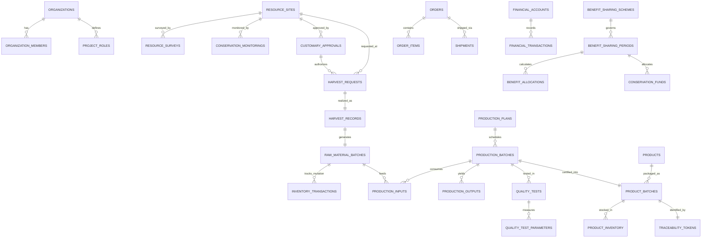

# Arsitektur & Perencanaan Modul CIBARANI GUANO pada BaMbooChain

**Platform Utama:** https://bamboochain.id  
**Nama Modul:** Cibarani Guano — *Biofertilizer, Traceability & Community Benefit Management*  
**Kolaborator Inti:** ASPAI (Asosiasi Penggiat Anggur Indonesia), Kasepuhan Cibarani (Kabupaten Lebak, Banten), Yayasan Sabumi Nusantara Jaya (YSNJ), dan Badan Usaha Pelaksana.

---

## 1. Hasil Audit Repository BaMbooChain

Berdasarkan audit menyeluruh terhadap repository `bamboochain-official`:

1. **Framework & Bahasa Pemrograman:**
   - **Frontend:** React `19.2.4` (ESM / JSX) dengan bundler **Vite `8.0.1`**.
   - **Routing:** `react-router-dom` `7.13.2` dengan `lazyWithRetry` (`React.lazy` + `Suspense`) di `src/App.jsx`.
   - **State Management:** **Zustand `5.0.13`** (digunakan pada modul enterprise seperti BoomBoom) dan React Context (`AuthContext`, `LanguageContext`, `ThemeContext`, `Web3Context`).
   - **UI & Visualisasi:** `lucide-react` `1.7.0` untuk ikonografi, `recharts` `3.8.1` untuk grafik analitik, serta CSS Variables adaptif Dark/Light Mode (`--bg-color`, `--bg-card`, `--bg-secondary`, `--text-main`, `--text-muted`, `--border-color`, `--primary`).
2. **Autentikasi & Database:**
   - **Autentikasi:** Firebase Authentication + profil pengguna di `src/context/AuthContext.jsx`.
   - **Database:** Cloud Firestore (`firebase` `12.13.0` di `src/firebase/config.js`) dengan dukungan fallback state lokal yang persisten (`localStorage` + koleksi Firestore `guano_*`).
3. **Deployment & Batasan Infrastruktur:**
   - **Hosting:** Vercel (dan Capacitor Android `id.bamboochain.app`).
   - **Batasan Penting Vercel:** Direktori `/api` saat ini sudah berisi tepat **12 Serverless Functions** (batas maksimum Vercel Hobby Plan). Oleh karena itu, seluruh business logic, validasi RBAC, proteksi stok/konservasi, dan persistensi Firestore harus diimplementasikan melalui *service layer* modular di `src/services/guano/` menggunakan SDK Firestore yang sudah ada tanpa menambah file baru di `/api/`.
4. **Sistem Navigasi 5 Kluster (`src/components/Navbar.jsx`):**
   - **Kluster 1 — Neraca Lingkungan:** ESG, Analitik Data & Dampak Karbon.
   - **Kluster 2 — Tobat Ekologi:** Restorasi Alam, Moralitas & Komunitas.
   - **Kluster 3 — Tanam Bambu Digital:** Tokenisasi Bambu, Dompet Web3 & Valuasi.
   - **Kluster 4 — Petani Milenial:** Pemberdayaan Petani, Edukasi & Koperasi (`Mitra & Petani Binaan`, `Daftar Jadi Petani`, `KODIBA`, `Akademi Silvikultur`, `Validator`).
   - **Kluster 5 — Pengusaha Milenial:** Konstruksi Hijau, Mobilitas, Pasar & Bisnis (`BangunIn`, `BoomBoom`, `Marketplace`, `Supply Chain`, `Build`, `Invest`).

---

## 2. Rekomendasi Penempatan dalam 5 Kluster BaMbooChain

Modul **Cibarani Guano** paling tepat ditempatkan pada:

1. **Kluster Utama: Kluster 4 — Petani Milenial (`4. Petani Milenial — Pemberdayaan Petani, Edukasi & Koperasi`)**
   - **Alasan Arsitektural & Bisnis:** Cibarani Guano adalah modul *Biofertilizer (Pupuk Organik Guano)* yang menghubungkan masyarakat adat Kasepuhan Cibarani, jaringan petani anggur & hortikultura ASPAI, serta pendampingan pemberdayaan masyarakat YSNJ. Penempatannya di Kluster 4 menyatukan hulu pertanian, edukasi budidaya, dan koperasi/pembagian manfaat komunitas.
2. **Jembatan Lintas-Kluster (Cross-Cluster Integration):**
   - **Pintasan Cepat (Quick Access Navbar Desktop & Mobile):** Ditampilkan sejajar dengan `BoomBoom` dan `BangunIn MBR` serta di dalam menu dropdown `bambuNUSA`.
   - **Integrasi ke Kluster 5 (Pengusaha Milenial):** Sub-modul *Marketplace & Orders* dan *Supply Chain & QR Traceability* terhubung langsung dengan `/bamboochain/marketplace` dan `/bamboochain/supply-chain`.
   - **Integrasi ke Kluster 2 (Tobat Ekologi):** Sub-modul *Conservation Tracker* dan *Dana Konservasi* selaras dengan misi restorasi & perlindungan ekosistem karst/gua kelelawar.

---

## 3. Rancangan ERD & Pemetaan 34 Entitas Konseptual

Seluruh 34 entitas konseptual pada spesifikasi dipetakan ke dalam skema terstruktur di `src/services/guano/` dan koleksi Firestore dengan prefix `cibarani_guano_*`:

### Daftar 34 Entitas & Aturan Integritas:
1. `organizations`: Entitas kolaborator (`ORG-ASPAI`, `ORG-KASEPUHAN`, `ORG-YSNJ`, `ORG-BUP`).
2. `organization_members`: Relasi pengguna ke organisasi & role.
3. `project_roles`: Matriks 12 role RBAC dan izin modul.
4. `resource_sites`: Registrasi zona/situs guano tanpa koordinat publik (`confidential_coords_encrypted`).
5. `resource_surveys`: Riwayat survei potensi & ekologi awal.
6. `conservation_monitorings`: Observasi habitat & aktivitas kelelawar (`Normal`, `Perlu Perhatian`, `Risiko Tinggi`, `Kegiatan Dihentikan`).
7. `customary_approvals`: Persetujuan adat Kasepuhan Cibarani & batas kuota panen lestari.
8. `harvest_requests`: Permohonan jadwal pengumpulan oleh Field Officer.
9. `harvest_records`: Realisasi pengumpulan terverifikasi.
10. `raw_material_batches`: Batch bahan baku guano mentah (`kg`).
11. `inventory_transactions`: Riwayat mutasi masuk/keluar/penyesuaian stok bahan baku (anti-negatif).
12. `production_plans`: Rencana produksi dan versi SOP/formula.
13. `production_batches`: Batch proses produksi (`Draft` s/d `Approved`/`Rejected`).
14. `production_inputs`: Pemakaian batch bahan baku & bahan tambahan.
15. `production_outputs`: Hasil bersih, susut proses, pengeringan, pengayakan, granulasi.
16. `quality_tests`: Header pengujian laboratorium per batch.
17. `quality_test_parameters`: Parameter uji terkonfigurasi (Kadar Air, pH, C-Organik, NPK, Logam Berat, Mikrobiologi).
18. `products`: Master katalog produk (`Cibarani Guano Powder`, `Cibarani Guano Granule`, `Cibarani Professional Series`).
19. `product_batches`: Batch produk jadi yang hanya berstatus `Ready for Sale` jika lulus QA.
20. `product_inventory`: Stok produk jadi siap distribusi.
21. `orders`: Pesanan pelanggan (`Pending Payment` s/d `Completed`/`Refunded`).
22. `order_items`: Detail item & batch pada pesanan.
23. `shipments`: Pengiriman & nomor resi/distribusi.
24. `traceability_tokens`: Token acak kriptografis non-sekuensial untuk pemindaian QR publik.
25. `financial_accounts`: Akun kas/bank/dana konservasi.
26. `financial_transactions`: Buku besar keuangan numerik (`Draft`, `Submitted`, `Approved`, `Rejected`, `Reconciled` — hanya bisa dikoreksi via *Reversal/Adjustment*).
27. `benefit_sharing_schemes`: Parameter skema bagi manfaat berlabel **ASUMSI — BELUM DISEPAKATI** (Konservasi 10%, Kasepuhan 50%, ASPAI 30%, Alokasi Program YSNJ 20%).
28. `benefit_sharing_periods`: Periode simulasi bulanan/kuartalan/tahunan.
29. `benefit_allocations`: Rincian hasil simulasi per pihak & status persetujuan berjenjang.
30. `conservation_funds`: Pencatatan penerimaan & penggunaan dana konservasi.
31. `impact_records`: Metrik tenaga kerja lokal, jam/hari kerja, dan kegiatan konservasi.
32. `documents`: Lampiran SOP, berita acara adat, dan sertifikat lab.
33. `notifications`: Notifikasi in-app untuk seluruh pergerakan status kritis.
34. `audit_logs`: Jejak audit tidak terhapuskan untuk setiap persetujuan, perubahan kuota, stok, mutu, keuangan, dan role.

---

## 4. Daftar File yang Ditambah & Diubah

### File Baru:
- `docs/cibarani-guano-architecture.md` — Dokumentasi arsitektur, ERD, dan analisis risiko.
- `docs/cibarani-guano-user-guide.md` — Panduan pengguna dan cara menguji 12 role RBAC.
- `docs/cibarani-guano-implementation-status.md` — Status implementasi seluruh 15 submenu & kriteria keberhasilan.
- `src/services/guano/guanoSeedData.js` — Data awal berlabel **DEMO** dan parameter **ASUMSI — BELUM DISEPAKATI** (volume sumber daya awal `null` / `Belum Disurvei`).
- `src/services/guano/guanoStore.js` — Zustand store + RBAC validator + business logic + sinkronisasi Firestore + generator CSV/Print report.
- `src/pages/guano/CibaraniGuanoPage.jsx` — Aplikasi terpadu 15 submenu Cibarani Guano dengan RBAC switcher, notifikasi in-app, filter, pencarian, dan state lengkap.
- `src/pages/guano/GuanoPublicTracePage.jsx` — Halaman publik pemindaian QR Traceability (`/cibarani-guano/trace/:token`) yang aman dari kebocoran lokasi gua.

### File yang Diubah (Tanpa Merusak Fitur Existing):
- `src/App.jsx` — Menambahkan rute `/cibarani-guano` dan `/cibarani-guano/trace/:token` serta metadata SEO.
- `src/components/Navbar.jsx` — Menambahkan menu **🦇 Cibarani Guano** ke **Kluster 4 (Petani Milenial)**, pintasan cepat (*Quick Access*), dan dropdown `bambuNUSA`.

---

## 5. Analisis Risiko Integrasi & Mitigasi

1. **Risiko Kebocoran Lokasi Gua / Koloni Kelelawar:**
   - *Mitigasi:* Field koordinat tidak pernah disimpan sebagai teks terbuka di entitas publik; halaman Resource Registry publik dan QR Traceability hanya menampilkan wilayah administratif umum (`Kecamatan Sobang / Wilayah Adat Kasepuhan Cibarani, Kab. Lebak, Banten`).
2. **Risiko Klaim Sepihak (Volume Guano, Mutu & Pembagian Dividen Yayasan):**
   - *Mitigasi:* Volume awal disetel `null` (`Belum Disurvei`), parameter finansial diberi badge **ASUMSI — BELUM DISEPAKATI**, dan bagian YSNJ secara tegas dilabeli **Alokasi Program YSNJ (Bukan Dividen)** tanpa fitur transfer otomatis.
3. **Risiko Batas 12 Serverless Functions di Vercel:**
   - *Mitigasi:* Tidak membuat file baru di folder `/api/`; seluruh transaksi dan audit log menggunakan service layer di `src/services/guano/guanoStore.js`.

